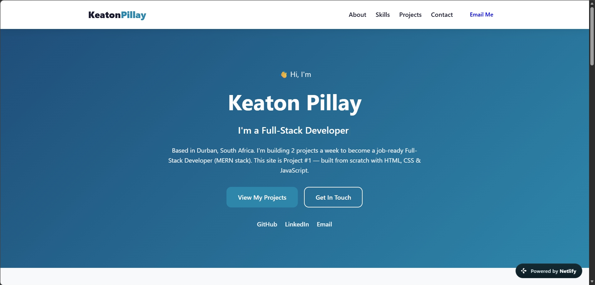

# Personal Portfolio Site — Project #01

[Live Demo](https://keatonpillay.netlify.app) | [GitHub Repo](https://github.com/Keatonpillay23/portfolio-project-1)

## What I Built
My personal portfolio website — Project 1 of my 12-week, 24-project Full-Stack journey (2 projects/week). A responsive single-page site built from scratch with vanilla HTML, CSS, and JavaScript. No frameworks, no templates — just fundamentals.

## Features
- Sticky navbar with mobile hamburger menu
- Hero section with typing animation (cycles through roles)
- About, Skills, Projects, and Contact sections
- Scroll-reveal animations (IntersectionObserver)
- Active nav link highlighting on scroll
- Contact form with JavaScript validation
- Fully responsive (mobile, tablet, desktop)
- Accessible (aria labels, semantic HTML)

## Tech Stack

## Run Locally
1. Clone the repo: `git clone https://github.com/Keatonpillay23/portfolio-project-1.git`
2. Open `index.html` in your browser (or use VS Code Live Server)
3. No build step needed — it's plain HTML/CSS/JS

## What I Learned
- Semantic HTML (`header`, `main`, `section`, `footer`) and why it matters for accessibility/SEO
- CSS variables, Flexbox, Grid, and responsive design with media queries
- DOM manipulation: `getElementById`, `addEventListener`, `classList.toggle`
- IntersectionObserver for scroll animations
- Form validation with regex
- Git workflow: init, add, commit, push, deploy

## What I'd Improve Next
- Connect the contact form to a real backend (Week 8)
- Add a dark mode toggle
- Add real project cards as I build Projects #02–#24

## Deployment
Deployed on Netlify (drag-and-drop or GitHub-connected). See live link above.
